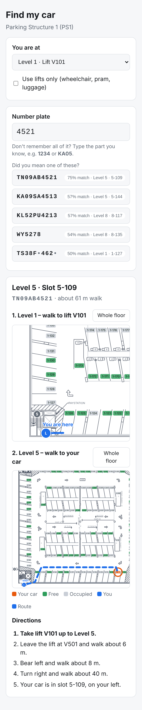
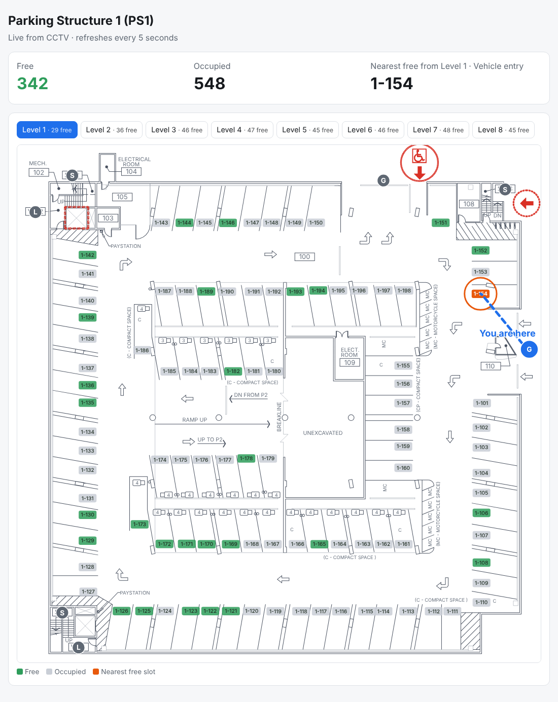

# Parking System

Find your car in a mall car park using the CCTV cameras that are already there.

 

1. **CCTV cameras** watch the parking slots. For every slot the system works out whether it is
   **occupied or free**, and reads the **number plate** of the car parked in it.
2. A visitor coming back from the mall **scans the QR code** at the entrance. The QR tells the
   site where they're standing (`/?kiosk=V101`).
3. They **type their number plate**, and the site shows the **slot on a map**, the **walking route**
   from where they're standing, and turn-by-turn directions.
4. **Partial plates work both ways:**
   - the camera only saw part of the plate (dirt, a pillar, a bad angle): unreadable characters are
     stored as `?` (e.g. `KL07?Z88?1`), or only the visible part is kept (`MH4321`);
   - the visitor only remembers part of it (`1234`, `KA05`).
   In both cases the site shows a **"Did you mean…?" list of suggestions** ranked by match score.
5. A live **availability board** (`/board`) shows free/occupied slots and the nearest free slot
   to the vehicle gate, for display screens at the entry.

```
 CCTV / NVR ──► vision worker (OpenCV + OCR) ──POST──► FastAPI server ──► SQLite
                  • slot occupancy                       • /api/search   (fuzzy plate match)
                  • plate reading                        • /api/route    (A* walking route)
                  • merge reads over time                • /api/slots, /api/nearest-free
                                                         • web pages: /  and  /board
 Visitor phone ──scan QR──► /?kiosk=V101 ─type plate──► suggestions ──► map + directions
```

## Quick start (demo mode, no cameras needed)

```bash
python -m pip install -r requirements-dev.txt
python -m uvicorn app.main:app --reload
```

- Find-my-car page: <http://localhost:8000/?kiosk=V101>  (try `KA05MH1234`, `4521`, `KL07AZ8851`)
- Availability board: <http://localhost:8000/board>

The default lot is **Parking Structure 1 (PS1)**, imported from its CAD floor plans:
8 levels, 890 slots, 2 lift shafts and 4 stairwells. A visitor on any floor gets a route like
"Take lift V101 up to Level 5 → walk 40 m → your car is in slot 5-109, on your left", with a
map of each floor they walk on. Tick "Use lifts only" to avoid stairs.

Demo mode (`PARKING_DEMO=1`, the default) fills the empty lot with fake cars, some with
partly-read plates. Set `PARKING_DEMO=0` in production.

(On Windows, using `python -m ...` avoids "uvicorn is not recognized" when pip's Scripts folder isn't on PATH.)

Run the tests:

```bash
python -m pytest -q
```

## Setting it up for a real car park

### 1. Get the lot layout into `config/`

**From CAD floor plans (recommended).** If you have the car park drawings as a PDF (one floor per
page, exported from AutoCAD etc.), import them:

```bash
python -m pip install -r requirements-tools.txt
python scripts/import_floorplan_pdf.py plans.pdf --out config/mylot/lot.json --name "My Car Park"
```

The importer reads the vector drawing (no tracing by hand):

| from the PDF | becomes |
|---|---|
| walls, stall lines, arrows | the map drawing **and** the walkable area for routing |
| labels like `1-143` (`--slot-regex`) | slot positions; the first digit is the floor |
| `V101`, `V201`... (`--lift-regex`) | lifts; same last two digits = same shaft, so routes can change floor |
| `S101`, `S201`... (`--stair-regex`) | stairwells (used the same way) |
| `ENTRY`, `EXIT`, `SKYBRIDGE` | named points |
| drawing scale (`--feet-per-inch`, default 32 for 1/32" = 1') | real walking distances in metres |

It warns about problems in the drawing. For example, PS1's Level 4 labels `4-150`, `4-152` and
`4-153` twice, so the second copies became `4-150-2` etc. Fix those in `lot.json` if you know the
real numbers.

**Hand-drawn grid (no CAD).** For a small lot, draw it as text; see `config/sample_grid_lot.json`:

| char | meaning |
|---|---|
| `#` | wall / not walkable |
| `.` | driveway / walkway |
| `A`–`Z` | a parking slot. IDs are the letter + position in that row: `A01`, `A02`, … |
| `G`, `1`–`9` | named points (vehicle gate, QR kiosks), defined under `points` |

Choose which lot the server uses with `PARKING_LOT_CONFIG=config/sample_grid_lot.json`.

### 2. Map cameras to slots
Add a `cameras` list to the lot config. For each camera, list its stream URL and a polygon (pixel coordinates in that camera's image)
for every slot it can see. Optionally save a photo of the **empty** lot as
`reference_image`; occupancy detection is much more reliable with it.

### 3. Run a vision worker per camera
```bash
pip install easyocr            # plate OCR
export PARKING_API_KEY=change-me   # same value on the server
python -m app.vision.worker --server http://SERVER:8000 --camera CAM-A-WEST
```
The worker samples a frame every few seconds, then:
- **occupancy**: compares each slot polygon to the empty reference + edge density, and only
  flips a slot after it's looked the same for 3 frames (people walking past don't count);
- **plates**: reads plates, assigns each to the slot polygon it's in, and **merges reads over
  time** so a `?` in one frame gets filled in by a later frame that saw that character;
- pushes changes to `POST /api/ingest/occupancy` and `POST /api/ingest/plate` (header `X-API-Key`).

The `PlateReader` interface in `app/vision/anpr.py` is pluggable. EasyOCR works for a start;
for production accuracy use a dedicated plate detector (e.g. a YOLO plate model) + OCR, or
your NVR's built-in ANPR, and post its results to the same ingest endpoints.

### 4. Print the QR codes
```bash
python scripts/make_qr.py --base-url https://parking.yourmall.com
```
Creates one QR per lift lobby, stairwell and kiosk on every floor (`qr/V101.png`, `qr/S302.png`, …;
50 for PS1). Stick each one next to the door with the same name, so the site knows which floor and
which door the visitor is standing at.

## How routing works (`app/navigation.py`)
Each floor's drawing is turned into a fine grid (about 0.4 m per cell for PS1); anything drawn
(walls, stall lines) is blocked. Paths are shortest walks that keep to the middle of aisles; between
floors the router tries every lift and stairwell and picks the quickest (a lift "costs" ~20 m of
waiting). The path is then simplified into a few legs and turned into "turn left / bear right"
directions, ending with which side of you the car is on.

## How partial matching works (`app/plate_matcher.py`)
- Input is normalised: `ka-05 mh 1234` → `KA05MH1234`; `*` or `_` can be typed as a wildcard.
- Score = weighted edit distance with **free gaps at either end**, so a fragment can match anywhere
  in a full plate (and a full query can match a fragment the camera stored).
- `?` matches anything at a small cost.
- Characters OCR mixes up (`0/O/D`, `1/I/L`, `8/B`, `5/S`, `2/Z`, …) are cheap substitutions.
- Results are lightly re-ranked by how confident the camera read was. An exact match is shown
  first and opens the route straight away; otherwise the top 5 suggestions are listed.

## API
| method | path | what |
|---|---|---|
| GET | `/api/lot` | floors, slots, points |
| GET | `/api/floors/{id}` | the floor drawing (for the map) |
| GET | `/api/slots` | free / occupied counts (total and per floor) and per-slot status (no plates) |
| GET | `/api/search?q=KA05` | plate suggestions with slot + match score |
| GET | `/api/route?from=V101&slot=5-109&lifts_only=false` | per-floor paths, distance and directions |
| GET | `/api/nearest-free?from=ENTRY-1` | nearest free slot (same floor first) |
| POST | `/api/ingest/occupancy` | `{camera_id, slots: {A01: true}}` (needs `X-API-Key`) |
| POST | `/api/ingest/plate` | `{camera_id, slot_id, plate, confidence}` (needs `X-API-Key`) |

Config via environment: `PARKING_LOT_CONFIG`, `PARKING_DB`, `PARKING_API_KEY`, `PARKING_DEMO`.

## Privacy
Plates are personal data. The public status endpoint never returns plates; search needs at least
3 known characters and returns at most 5 results; a plate is deleted as soon as the slot becomes
free. Before going live you should also add rate limiting on `/api/search`, and consider showing
masked plates in suggestions, depending on local rules.

## Roadmap ideas
- Car photo thumbnail in suggestions so people can recognise their car
- "Text me my slot" / save to phone
- Entry/exit gate ANPR for parking duration and payment
